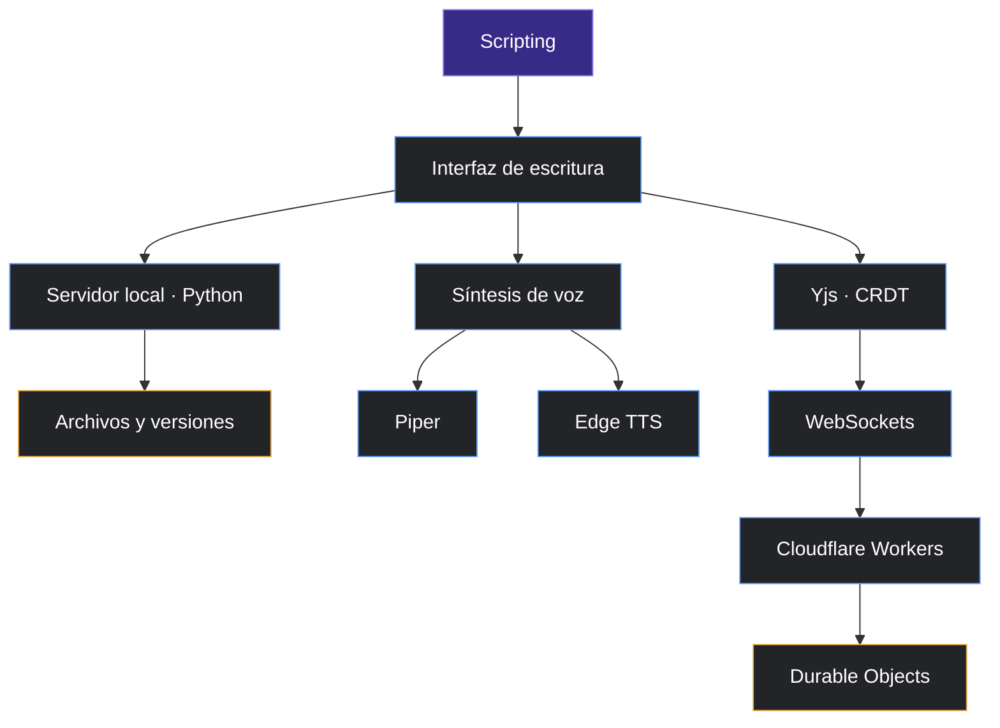

 

 

 

  

[Escritura](#escritura) ·
[Arquitectura narrativa](#arquitectura-narrativa) ·
[Preproducción](#preproducción) ·
[Colaboración](#colaboración) ·
[Instalación](#instalación)

---

## Escritura

Dos entornos de escritura especializados, adaptados a las necesidades de cada formato.

### Guion cinematográfico

Un editor de guiones inspirado en el flujo de trabajo de Final Draft.

- Formato cinematográfico y paginación automática.
- Autocompletado de personajes y encabezados de escena.
- Navegación inteligente por escenas.
- Formato contextual mediante Enter y Tab.
- Estadísticas de personajes, diálogos y locaciones.

### Novela

Un espacio dedicado a la escritura de narrativa en prosa, con herramientas para desarrollar y revisar manuscritos extensos.

<table>
<tr>
<td width="55%">

</td>
<td width="45%">

**Organización y revisión**

- Capítulos y escenas.
- Gestión de puntos de vista.
- Objetivos diarios de escritura.
- Revisión de estilo.
- Modo de sugerencias.
- Corrector de español argentino.

</td>
</tr>
</table>

---

## Arquitectura narrativa

La escritura no comienza necesariamente en una página en blanco. Scripting incorpora herramientas para construir, visualizar y reorganizar la estructura de una historia.

### Story Map

Visualizá el desarrollo narrativo directamente sobre la extensión de tu manuscrito.

### Del concepto a la estructura

<table>
<tr>
<td width="50%" valign="top">

<h3>Beat Board</h3>

Organizá acontecimientos narrativos mediante tarjetas, colores y conexiones. Explorá distintas estructuras sin modificar el manuscrito.

</td>
<td width="50%" valign="top">

<h3>Plantillas narrativas</h3>

Utilizá estructuras predefinidas como punto de partida para desarrollar actos, secuencias y acontecimientos.

</td>
</tr>
</table>

### Biblia narrativa

Centralizá la información de tu universo narrativo: personajes, relaciones, lugares, temas, imágenes y referencias.

Una base de conocimiento integrada en el propio proyecto.

---

## Preproducción

### Del guion a la pantalla

Transformá escenas escritas en secuencias visuales mediante un storyboard integrado.

- Organización de cuadros por escena.
- Tipos de plano y movimientos de cámara.
- Descripciones y referencias visuales.

### Escuchá tu historia

Asigná voces individuales a tus personajes y reproducí el guion como una lectura dramatizada.

| Motor de voz | Procesamiento | Conexión |
| :--- | :--- | :--- |
| **Edge TTS** | Remoto | Requerida |
| **Piper** | Local | No requerida una vez descargadas las voces |

Una herramienta para evaluar el ritmo, la duración y la naturalidad de los diálogos.

---

## Colaboración

### Historias compartidas

Escribí, revisá y desarrollá historias junto a otros autores en tiempo real.

<table>
<tr>
<td width="50%">

</td>
<td width="50%">

- Edición simultánea.
- Salas privadas de escritura.
- Gestión de usuarios e invitaciones.
- Comentarios y sugerencias.
- Sincronización mediante CRDT.
- Historial y comparación de versiones.

</td>
</tr>
</table>

La infraestructura colaborativa puede desplegarse en tu propia cuenta de Cloudflare, sin depender de un servidor central administrado por Scripting.

---

## Tus historias, tus archivos.

Scripting está diseñado bajo un enfoque **local-first**.

Tus manuscritos permanecen en tu computadora. Podés trabajar sin conexión a internet y utilizar las herramientas colaborativas cuando las necesites.

| Almacenamiento local | Independencia | Control |
| :--- | :--- | :--- |
| Archivos en tu computadora. | Escritura sin conexión. | Infraestructura colaborativa propia. |

Los proyectos se almacenan en `Documentos\Guiones`.

Actualizar o desinstalar Scripting no elimina tus manuscritos.

---

## Exportación y publicación

Desde un borrador de trabajo hasta un documento preparado para producción o publicación.

| Formato | Guion | Novela |
| :--- | :---: | :---: |
| PDF | ✓ | ✓ |
| Final Draft (.fdx) | ✓ | — |
| Fountain | ✓ | — |
| Microsoft Word | ✓ | ✓ |
| EPUB | — | ✓ |

Configuración de márgenes, dimensiones de página, numeración y presentación del documento.

---

## Tecnología

Scripting combina una interfaz web con servicios locales y una arquitectura de sincronización distribuida.

| Componente | Tecnología |
| :--- | :--- |
| Interfaz | HTML, CSS y JavaScript |
| Servicios locales | Python |
| Sincronización | Yjs, CRDT y WebSockets |
| Infraestructura remota | Cloudflare Workers y Durable Objects |
| Síntesis de voz | Piper y Edge TTS |
| Corrección ortográfica | nspell y diccionario es_AR |

---

## Instalación

**Requisitos:** Windows 10 o Windows 11.

1. Descargá el instalador desde [GitHub Releases](https://github.com/MEMNSz/scripting/releases/latest).
2. Ejecutá el instalador y seguí las instrucciones.
3. Abrí Scripting y creá tu primer proyecto.

No requiere permisos de administrador.

### Actualizaciones

Scripting incorpora un sistema de actualizaciones integrado. Cuando se publica una nueva versión, puede descargarse e instalarse desde la propia aplicación.

> [!NOTE]
> El instalador no cuenta actualmente con firma digital. Windows SmartScreen puede mostrar una advertencia durante la instalación.

---

## Licencia

Scripting es software libre bajo la licencia **MIT**: podés usarlo, copiarlo, modificarlo y compartirlo, siempre que conserves el aviso de autoría.

Consultá [LICENSE](LICENSE) para ver el texto completo y las licencias de los componentes de terceros.

---

**Scripting**

*Un proyecto independiente, desarrollado por Claude y el vibe coding.*

 

[Descargar](https://github.com/MEMNSz/scripting/releases/latest) ·
[Reportar un problema](https://github.com/MEMNSz/scripting/issues) ·
[Versiones](https://github.com/MEMNSz/scripting/releases)

© 2026 MEMNSz

